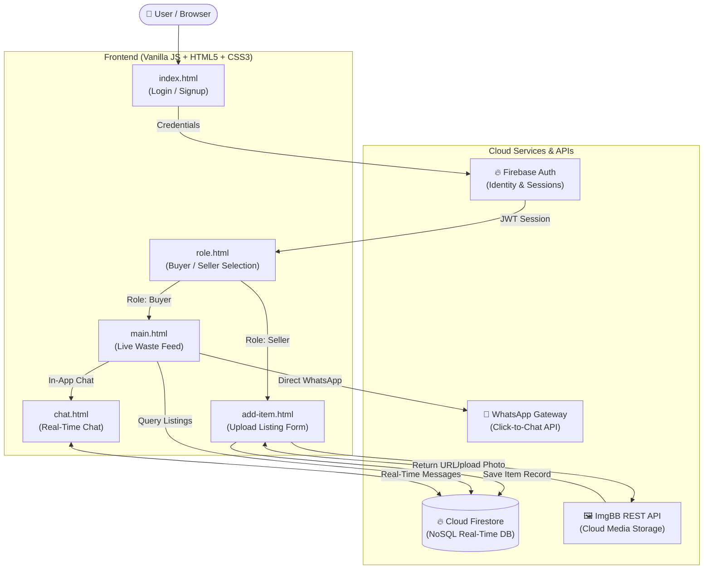

# ♻️ Waste Marketplace — Peer-to-Peer Smart Waste Management Platform

[](https://firebase.google.com/)
[](https://developer.mozilla.org/en-US/docs/Web/JavaScript)
[](https://developer.mozilla.org/en-US/docs/Glossary/HTML5)
[](https://developer.mozilla.org/en-US/docs/Web/CSS)
[](https://imgbb.com/)
[](https://www.whatsapp.com/)
[](#)

> **A Problem-Based Learning (PBL) Project for sustainable waste management, recycling, and circular economy empowerment.**

---

## 📌 Table of Contents

- [Overview](#-overview)
- [Problem Statement](#-problem-statement)
- [Key Features](#-key-features)
- [System Architecture](#-system-architecture)
- [Data Model & Schema](#-data-model--schema)
- [Tech Stack](#-tech-stack)
- [Project Structure](#-project-structure)
- [Getting Started](#-getting-started)
- [Configuration](#-configuration)
- [Future Roadmap](#-future-roadmap)
- [Author & Acknowledgments](#-author--acknowledgments)
- [License](#-license)

---

## 🌍 Overview

**Waste Marketplace** is a full-stack, decentralized peer-to-peer web platform designed to streamline the lifecycle of recyclable and reusable waste. It connects waste generators (households, offices, small workshops) directly with recyclers, scrap dealers, upcyclers, and commercial buyers.

By removing traditional scrap intermediaries, the platform incentivizes responsible disposal, maximizes material recovery, and accelerates the transition to a **Circular Economy**.

---

## 💡 Problem Statement

Traditional waste collection suffers from several inefficiencies:
1. **Low Recycling Rates**: Massive volumes of recyclable metals, paper, plastics, and e-waste end up in landfills.
2. **Lack of Price Transparency**: Households and small businesses receive arbitrary, low valuations for scrap materials.
3. **Information Barrier**: Buyers and recyclers struggle to source specific waste fractions locally and cost-effectively.

**Waste Marketplace** solves this by providing a unified digital portal where sellers can list waste with photos, categories, and prices, and buyers can browse listings and initiate instant contact.

---

## ✨ Key Features

- **🔐 Firebase Authentication**:
  - Secure email & password signup and login.
  - Persistent authentication state with `onAuthStateChanged`.
  - Route protection across all authenticated pages.
  - Dedicated sign-out handler with session cleanup.

- **👥 Role-Based Experience**:
  - Choose between **Seller** and **Buyer** workflows.
  - Sellers are routed straight to item creation; Buyers land on the marketplace feed.

- **📦 Multi-Category Waste Listings**:
  - Specialized classification for **Plastic**, **Paper**, **Metal**, **Furniture**, and **Electronics**.
  - Dynamic listing form with expected price (₹) and seller contact info.

- **📸 Cloud Image Hosting**:
  - Seamless image uploads powered by the **ImgBB REST API**.
  - Client-side base64 conversion with automatic public URL generation.

- **⚡ Real-Time Feed & Cloud Firestore**:
  - Live, real-time database queries ordered chronologically by timestamp.
  - Adaptive cards displaying item name, seller name, category, price, and photo.
  - Built-in fallback styling to handle broken or missing image links gracefully.

- **💬 Dual Communication Channels**:
  - **WhatsApp Redirection**: Direct 1-click WhatsApp messaging (`https://wa.me/...`) for external coordination.
  - **In-App Real-Time Chat**: Dedicated Firestore-backed chat interface with instant message synchronization and query-parameter seller binding.

- **🛡️ Author Protection**:
  - Listings automatically detect the current user's UID to prevent users from messaging themselves on their own items.

- **🧭 Responsive Navigation Bar**:
  - Fixed mobile-friendly bottom navigation bar for **Home**, **Post Item**, **Messages**, and **Logout**.

---

## 🏗️ System Architecture



---

## 🗄️ Data Model & Schema

The application uses Google Cloud Firestore with two primary collections:

### 1. `items` Collection
Stores every waste item listed by sellers on the marketplace.

| Field | Type | Description |
| :--- | :--- | :--- |
| `sellerId` | `string` | UID of the user who posted the item |
| `sellerName` | `string` | Name of the seller displayed on the post |
| `phoneNumber` | `string` | Phone number with country code (e.g. `+91...`) |
| `name` | `string` | Title/name of the waste item |
| `price` | `string` / `number` | Expected price in ₹ (INR) |
| `type` | `string` | Category (`plastic`, `paper`, `metal`, `furniture`, `electronic`) |
| `imageUrl` | `string` | Public CDN URL returned by ImgBB API |
| `timestamp` | `serverTimestamp` | Exact Firestore server creation timestamp |

### 2. `messages` Collection
Stores bidirectional chat messages between buyers and sellers.

| Field | Type | Description |
| :--- | :--- | :--- |
| `senderId` | `string` | UID of the user sending the message |
| `receiverId` | `string` | UID of the recipient (seller/buyer) |
| `text` | `string` | The text content of the message |
| `timestamp` | `serverTimestamp` | Server timestamp for chronological sorting |

---

## 💻 Tech Stack

- **Frontend**: Vanilla HTML5, CSS3, Modern JavaScript (ES6 Modules)
- **Backend-as-a-Service**: Firebase 10.8.1
  - **Firebase Authentication**: User accounts and session tokens
  - **Cloud Firestore**: Real-time NoSQL cloud database
- **Storage**: ImgBB API for image hosting
- **Third-Party Messaging**: WhatsApp URL Scheme (`wa.me`)
- **Testing & Verification**: Node.js & Chrome DevTools Protocol (CDP) automated test harness

---

## 📂 Project Structure

```
PBL_PROJECT_WASTEMANAGEMENT/
│
├── index.html            # User authentication (Login & Signup)
├── role.html             # Role selector (Buyer vs. Seller)
├── main.html             # Marketplace feed with live post cards & bottom navigation
├── add-item.html         # Sell waste item submission form
├── chat.html             # Real-time peer-to-peer chat interface
│
├── script.js             # Authentication handlers, logout, and feed rendering logic
├── add-item.js           # ImgBB image upload and Firestore document creation
├── chat.js               # Real-time Firestore snapshot listener and message dispatcher
├── firebase-config.js    # Firebase App, Auth, and Firestore initialization
├── style.css             # Global styling, responsive layout, and gradient theme
│
└── README.md             # Complete project documentation
```

---

## 🚀 Getting Started

### Prerequisites
Because the project uses native JavaScript **ES6 Modules** (`import ... from ...`), files must be served over an HTTP/HTTPS protocol rather than `file://`.

Ensure you have one of the following installed:
- [Python 3.x](https://www.python.org/)
- [Node.js](https://nodejs.org/) (optional, for `npx serve` or `http-server`)
- [VS Code Live Server Extension](https://marketplace.visualstudio.com/items?itemName=ritwickdey.LiveServer)

### 1. Clone the Repository
```bash
git clone https://github.com/DhaneshUdayPujare/PBL_PROJECT_WASTEMANAGEMENT.git
cd PBL_PROJECT_WASTEMANAGEMENT
```

### 2. Run Locally

#### Option A: Using Python (Recommended)
```bash
python -m http.server 8000
```

#### Option B: Using Node.js
```bash
npx serve .
```

#### Option C: Using VS Code
Right-click on `index.html` and select **"Open with Live Server"**.

### 3. Open in Browser
Visit `http://localhost:8000` in your web browser.

---

## ⚙️ Configuration

The project is pre-configured with active Firebase and ImgBB credentials in:
- `firebase-config.js`: Firebase Project configuration.
- `add-item.js`: ImgBB REST API upload key.

To use your own credentials:
1. Create a Firebase project at [Firebase Console](https://console.firebase.google.com/).
2. Enable **Email/Password** provider under **Authentication**.
3. Create a **Cloud Firestore** database.
4. Replace the `firebaseConfig` object in `firebase-config.js`:
   ```javascript
   const firebaseConfig = {
     apiKey: "YOUR_API_KEY",
     authDomain: "YOUR_PROJECT.firebaseapp.com",
     projectId: "YOUR_PROJECT_ID",
     storageBucket: "YOUR_PROJECT.appspot.com",
     messagingSenderId: "YOUR_SENDER_ID",
     appId: "YOUR_APP_ID"
   };
   ```
5. Get a free API key from [ImgBB API](https://api.imgbb.com/) and replace `imgbbApiKey` in `add-item.js`.

---

## 🗺️ Future Roadmap

- [ ] **GPS / Geolocation Tracking**: Filter waste listings by distance radius (e.g. within 5km).
- [ ] **AI Material Classifier**: Integrate Gemini Vision to classify waste type and estimate weight automatically from photos.
- [ ] **Integrated Escrow Payments**: Safe digital payments upon pickup confirmation.
- [ ] **Eco-Credits & Gamification**: Reward active recyclers with sustainability points and badges.
- [ ] **Scrap Price Index**: Real-time market rates for copper, aluminum, paper, and plastics.

---

## 👨‍💻 Author & Acknowledgments

- **Dhanesh Uday Pujare** — *Lead Developer & Architect*
  - GitHub: [@DhaneshUdayPujare](https://github.com/DhaneshUdayPujare)
  - Project: Problem-Based Learning (PBL) Waste Management

Special thanks to faculty mentors and the open-source community for resources and guidance on sustainable software engineering.

---

## 📄 License

This project is licensed under the [MIT License](LICENSE) — feel free to use and adapt it for academic and sustainability initiatives.
